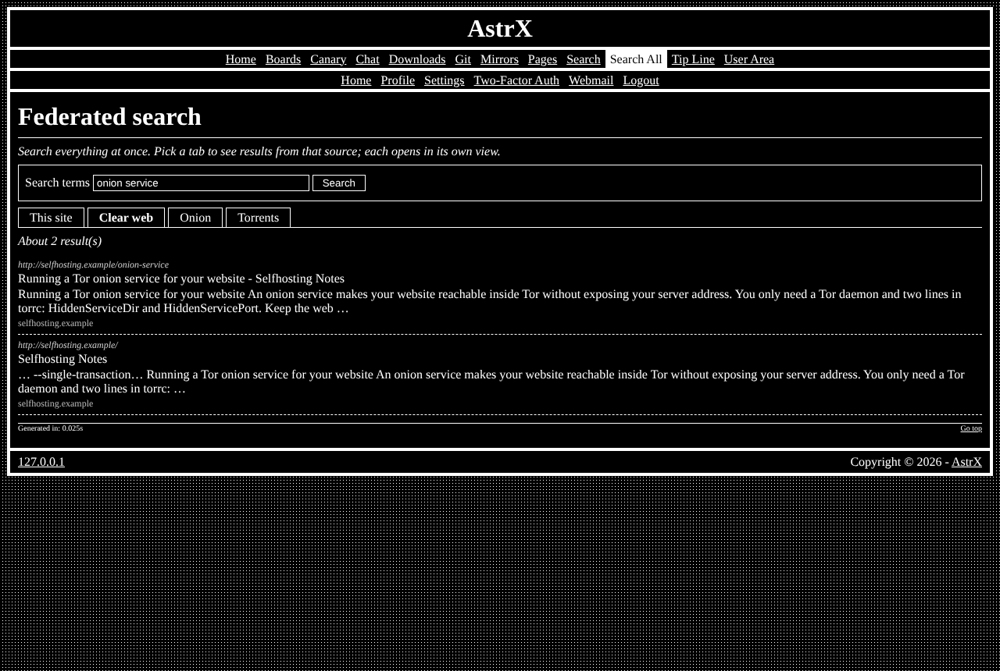

# astrx/module-fedsearch

> **Retired.** Its job now belongs to the site's one Search page
> ([module-search](https://github.com/Vxmdzhb/module-search)): the engine
> modules ([module-websearch](https://github.com/Vxmdzhb/module-websearch),
> [module-onionsearch](https://github.com/Vxmdzhb/module-onionsearch),
> [module-torrentsearch](https://github.com/Vxmdzhb/module-torrentsearch))
> each add a tab there. [AstrX](https://github.com/Vxmdzhb/astrx) no longer
> installs this module, and its update removes the "Search all" page. This
> repository is kept, read-only, for the history.
>
> To move a site off it: remove `astrx/module-fedsearch` from `composer.json`
> `FederatedSearchModule` from `ApplicationModules::INSTALLED` and `fedsearch`
> from `Modules.config.php`, then run
> `php tools/install.php --schema-only`.

Federated search across site content and the astrx-suite engines — the **Federated search** module of [AstrX](https://github.com/Vxmdzhb/astrx).



- Module key: `fedsearch` (switch it on in the site's `resources/config/Modules.config.php`)
- Pages: `federated_search`
- Requires: `astrx/cms`, `astrx/framework`, `astrx/library`, `astrx/module-search`

It ships its own templates, catalogs (en, it), default configuration and SQL in
`resources/`; the site overrides any of them from its own `resources/`.

AstrX isn't on Packagist and doesn't tag versions: you install from each
repository's `main`, and your `composer.lock` pins the exact commit. Tell
Composer where to find the package and the AstrX packages it depends on:

```json
{
    "minimum-stability": "dev",
    "prefer-stable": true,
    "repositories": [
        { "type": "vcs", "url": "https://github.com/Vxmdzhb/module-fedsearch" },
        { "type": "vcs", "url": "https://github.com/Vxmdzhb/cms" },
        { "type": "vcs", "url": "https://github.com/Vxmdzhb/framework" },
        { "type": "vcs", "url": "https://github.com/Vxmdzhb/library" },
        { "type": "vcs", "url": "https://github.com/Vxmdzhb/module-search" }
    ]
}
```

Then:

```sh
composer require astrx/module-fedsearch:dev-main
```

After that, list `AstrX\FederatedSearch\FederatedSearchModule::class` in the
site's `ApplicationModules::INSTALLED` and run the installer to create its
tables. See [modules](https://github.com/Vxmdzhb/astrx/blob/main/docs/MODULES.md).

Issues and pull requests are welcome here. [AstrX](https://github.com/Vxmdzhb/astrx)
is the site that puts all the packages together.

## License

Released under the [Do Whatever License](LICENSE), with a code of conduct
in the same spirit: [CODE_OF_CONDUCT](CODE_OF_CONDUCT).
